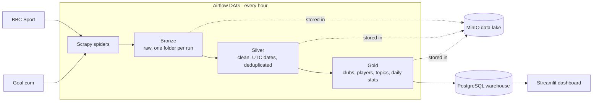

# ⚽ Football Analytics

[](https://github.com/FukkaTsu00/football-analytics/actions/workflows/ci.yml)


An hourly data pipeline that collects football news from **BBC Sport** and **Goal.com**, processes it through a **medallion architecture** (bronze → silver → gold) and loads it into a **PostgreSQL** warehouse — orchestrated by **Apache Airflow**, stored in a **MinIO** data lake, explored through a **Streamlit** dashboard and fully containerized with **Docker Compose**.


---

## Architecture



| Layer | Content | Storage |
|---|---|---|
| **Bronze** | Raw scraped articles, exactly as received. One immutable folder per run: `bronze/date=YYYY-MM-DD/run=<timestamp>/<source>.json` | MinIO |
| **Silver** | Clean text, UTC timestamps, one record per article (deduplicated across hourly runs) + a data-quality report | MinIO |
| **Gold** | Each article tagged with clubs, players and topics + daily statistics | MinIO |
| **Warehouse** | Tables `articles`, `article_topics`, `article_entities`, `pipeline_runs` | PostgreSQL |

### Airflow DAG

```
scrape_bbc  ─┐
             ├─► build_silver ─► build_gold ─► load_warehouse
scrape_goal ─┘
```

Runs hourly, with retries. `build_silver` runs even if one source fails, so the other source's data is never lost.

---

## Dashboard

A Streamlit dashboard reads the warehouse and refreshes every 5 minutes:

- **Overview**: articles per day and per source, publication hours, topic distribution
- **Clubs & players**: most mentioned clubs and players, and a club's mentions over time
- **Articles**: table filtered by topic and club, with links to the original articles
- **Data quality**: per-day report from the silver layer (raw items, duplicates removed, articles dropped)

---

## Design decisions

- **Immutable bronze.** Every run writes its own partition, so a failed or repeated run never corrupts history, and silver can always be rebuilt from the raw data.
- **Idempotent processing.** Silver rebuilds a whole day; the warehouse load deletes then inserts inside a single transaction. Re-running any task (for example an Airflow retry) gives the same result — never duplicates.
- **Fail loudly.** A spider returning 0 articles fails its task (usually a sign the site changed its HTML), and silver writes a quality report saying what it dropped and why.
- **Polite, legal scraping.** `robots.txt` is respected, the bot identifies itself honestly and requests are rate-limited (1 request/second per site, with autothrottle). A third source, L'Équipe, was deliberately dropped because its `robots.txt` disallows all crawlers.
- **Swappable infrastructure.** The pipeline talks to a storage interface (MinIO or a local folder) and a SQLAlchemy URL (PostgreSQL or SQLite), all configured through environment variables. The same code runs in Docker, on a laptop and in CI.
- **Thin DAG.** The Airflow DAG only wires tasks together; all logic lives in a tested Python package that can also be run from the command line.

---

## Tech stack

| Area | Tools |
|---|---|
| Ingestion | Scrapy |
| Orchestration | Apache Airflow 2.10 (LocalExecutor) |
| Data lake | MinIO (S3-compatible) |
| Warehouse | PostgreSQL 16, SQLAlchemy |
| Dashboard | Streamlit, Plotly, pandas |
| Infrastructure | Docker, Docker Compose |
| Quality | pytest, ruff, GitHub Actions |

---

## Getting started

### Requirements

- Docker Desktop (about 4 GB of RAM allocated)
- Python 3.11 (only for local development and tests)

### Run the full stack

```bash
cp .env.example .env        # then set your own passwords
docker compose up -d --build
```

| Service | URL |
|---|---|
| Airflow UI | http://localhost:8080 (user `admin`, password from `.env`) |
| Dashboard | http://localhost:8501 |
| MinIO console | http://localhost:9001 |
| PostgreSQL warehouse | `localhost:5440` |

In the Airflow UI, turn on the `football_pipeline` DAG: it then runs every hour.

> **Note on MinIO:** MinIO stopped publishing its Docker images in 2026 and `minio/minio` was removed from Docker Hub. The compose file uses a locally cached image (`pull_policy: never`). On a new machine, replace the `minio` service image with a maintained S3-compatible alternative — no code change is needed, only the image and credentials.

### Query the warehouse

```bash
docker compose exec postgres-dw psql -U football -d football_dw -c \
  "SELECT entity, COUNT(*) AS mentions FROM article_entities
   WHERE entity_type = 'club' GROUP BY entity ORDER BY mentions DESC LIMIT 10;"
```

### Run without Docker (development)

```bash
python -m venv .venv
source .venv/bin/activate            # Windows: .venv\Scripts\activate
pip install -r requirements-dev.txt
pip install -e .

python -m football_analytics scrape all          # bronze  (written to data/lake/)
python -m football_analytics silver              # silver
python -m football_analytics gold                # gold
python -m football_analytics load                # warehouse
python -m football_analytics all --skip-scrape   # silver + gold + load in one command

pip install -r requirements-dashboard.txt
streamlit run app/dashboard.py                   # dashboard on http://localhost:8501
```

---

## Tests

```bash
pytest -v
```

The test suite runs **offline and without Docker**: storage uses a temporary folder, the warehouse a temporary SQLite database, and the spider tests a small fake Scrapy project. It covers:

- text cleaning, UTC date normalisation and article IDs
- deduplication across runs and the data-quality report
- whole-word club, player and topic matching
- idempotent warehouse loads (no duplicates when a load is repeated)
- spider execution and failure reporting
- an end-to-end run on real scraped articles, and the command-line interface

On every push, GitHub Actions runs `ruff` and the full test suite, and checks that Airflow can load the DAG.

---

## Project structure

```
football-analytics/
├── .github/workflows/ci.yml     CI: lint, tests, DAG check
├── app/
│   └── dashboard.py             Streamlit dashboard on the warehouse
├── dags/
│   └── football_pipeline.py     Airflow DAG (wires the tasks together)
├── docker/
│   └── dashboard.Dockerfile     dashboard image
├── scraper/                     Scrapy project
│   └── football_scraper/
│       ├── settings.py          polite crawling settings
│       └── spiders/             BBC Sport and Goal.com spiders
├── src/football_analytics/
│   ├── bronze.py                run a spider, store the raw run
│   ├── silver.py                clean, normalise, deduplicate, quality report
│   ├── text.py                  text and date helpers
│   ├── gold.py                  club / player / topic tagging, daily stats
│   ├── warehouse.py             idempotent load into SQL
│   ├── storage.py               MinIO / local-folder storage
│   ├── config.py                settings from environment variables
│   └── cli.py                   run any stage from the command line
├── tests/                       pytest suite + small real-data fixtures
├── docker-compose.yml           PostgreSQL x2, MinIO, Airflow, dashboard
├── Dockerfile                   Airflow image with the project's dependencies
└── .env.example                 configuration template (copy to .env)
```

---

## Roadmap

- [x] Dashboard (Streamlit) on top of the warehouse
- [ ] NLP: replace keyword tagging with named-entity recognition and a topic classifier, measured against the current keyword baseline
- [ ] Match outcome prediction from historical results combined with news signals (e.g. injuries)
- [ ] Public hosted demo

---

## Data and ethics

Articles are collected only from pages that each site's `robots.txt` allows, at a low request rate, for a non-commercial educational project. The test fixtures contain a small sample with article text shortened to 300 characters. All article content remains the property of its publishers.